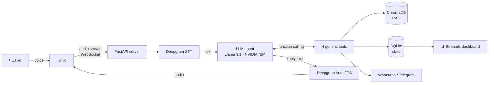

[README (2).md](https://github.com/user-attachments/files/34547335/README.2.md)
# MAYA---Multi-Domain-Voice-Agentic-AI-
Real-time voice AI agent that books, prices and confirms over live calls — one agentic pipeline across restaurant, hospital, hotel, flight and salon domains with zero code changes.
# Multi-Domain Voice Agentic AI

**Maya** is a real-time voice AI agent that answers phone calls and **completes tasks**: it answers questions from a knowledge base, calculates prices, creates a booking and sends the caller a confirmation on WhatsApp, all within one live conversation.

One agentic pipeline serves **five industries (restaurant, hospital, hotel, flight, salon)** with **zero backend changes**. Each business is a config folder. The code never branches on the domain.

> 📄 The research paper on this project was published in **JAAFR**, November 2026 (Paper ID 516451).

---

## What makes it different

Most voice bots are **retrieval-only Q&A**: they read answers back to you. Maya performs **write-actions** that change real-world state:

| Capability | Typical voice bot | Maya |
|---|---|---|
| Answer questions from a knowledge base | ✅ | ✅ |
| Calculate a price with discounts and charges | ❌ | ✅ |
| Create a real booking with a reference ID | ❌ | ✅ |
| Send a confirmation to the caller | ❌ | ✅ |
| Switch industry without code changes | ❌ | ✅ |

---

## How a call works



1. **Twilio** receives the call and streams the audio to the **FastAPI** server over a WebSocket.
2. **Deepgram STT** turns speech into text in real time.
3. The **LLM** (Llama 3.1 8B Instruct via NVIDIA NIM, OpenAI-compatible API) runs with the domain's persona and decides what to do next.
4. When it needs to act, it calls one of the **four generic tools** using function calling.
5. **Deepgram Aura TTS** speaks the reply back to the caller.
6. Every call and booking is written to **SQLite**, and the **Streamlit dashboard** shows live metrics.

---

## Tech stack

| Layer | Technology | Role |
|---|---|---|
| Telephony | **Twilio** (Voice + WhatsApp) | Inbound calls, call IDs, WhatsApp confirmations |
| Speech-to-text | **Deepgram** | Real-time transcription |
| Text-to-speech | **Deepgram Aura** | Natural voice replies |
| LLM | **Llama 3.1 8B Instruct** on **NVIDIA NIM** | Reasoning and tool selection, via the `openai` SDK |
| Agent pattern | **Function / tool calling** | LLM picks and runs tools in multi-step loops |
| RAG | **ChromaDB** (default ONNX embedder) | Per-domain knowledge retrieval, no PyTorch needed |
| Backend | **FastAPI**, **Uvicorn**, **WebSockets** | Call handling and audio streaming |
| Database | **SQLite** (WAL mode) | Calls, bookings and metrics; single source of truth |
| Dashboard | **Streamlit** + `streamlit-autorefresh` | Live analytics |
| Messaging | **Twilio WhatsApp API**, **Telegram Bot API** | Booking confirmations |
| Config | **YAML** (PyYAML), **python-dotenv** | Domain packs and secrets |
| Language | **Python 3** | |

---

## The core idea: four generic tools

The agent has **only four tools**, and none of them know which industry they're serving. A restaurant table, a hospital appointment, a hotel room and a flight seat are all expressed the same way:

```
service_id + quantity + datetime + notes
```

| Tool | Type | What it does |
|---|---|---|
| `search_knowledge(query)` | Read | RAG search over the domain's knowledge base (menu, services, prices, hours, policies) |
| `calculate_total(line_items, modifiers)` | Compute | Subtotal, then applies modifiers such as `member_discount` or `service_charge`, with the rates read from the domain config |
| `create_booking(service_id, datetime, quantity, customer)` | **Write** | Saves the booking to SQLite and returns a reference ID such as `RES-713DC3` |
| `send_confirmation(channel, to, ref_id, summary)` | **Write** | Sends the confirmation over WhatsApp, Telegram, or console (for testing) |

**Example call (restaurant):**

> **Caller:** "I'd like a table for 4 tonight at 8, I'm a member."
> **Maya:** `search_knowledge` → `calculate_total` (10% member discount + 5% service charge) → `create_booking` → `send_confirmation`
> **Maya:** "Done! Your table is booked, reference RES-713DC3. I've sent the details to your WhatsApp."

---

## Multi-domain: config, not code

Every business is a folder:

```
domains/
└── restaurant/
    ├── config.yaml     # persona, greeting, pricing rules, confirmation template
    └── kb/
        └── menu.md     # knowledge base for RAG
```

```yaml
domain_id: restaurant
display_name: "Spice Garden Restaurant"
greeting: "Thanks for calling Spice Garden, how can I help you today?"
booking_noun: "table reservation"
currency: "INR"
pricing_rules:
  member_discount: 0.10
  service_charge: 0.05
confirmation_template: "Spice Garden: reservation {ref_id} confirmed - {summary}. See you soon!"
```

**To add a new industry:** create `domains/<name>/config.yaml` and `domains/<name>/kb/*.md`, then run with `DOMAIN=<name>`. No Python changes.

---

## Reliability design

- **Idempotent bookings:** if the LLM fires `create_booking` twice for the same call, service and time, it gets the **same reference ID** back. There is never a duplicate booking.
- **Idempotent calls:** the Twilio CallSid is the primary key (`INSERT OR IGNORE`), so a retried webhook can't double-count a call.
- **Derived metrics:** every dashboard number is a live SQL query. Nothing is a hand-maintained counter, so the metrics can't drift or freeze.
- **Concurrent access:** SQLite runs in **WAL mode**, so the dashboard can read while a call is writing without blocking it.
- **Graceful fallbacks:** if ChromaDB or messaging credentials aren't available, the tools fall back to raw KB search and console output. The core runs with **zero API keys**.

---

## Dashboard metrics

All metrics are computed directly from SQLite:

- Active calls
- Total conversations
- Tasks completed
- Average user rating
- Calls per domain
- Recent conversations: transcript, tools used, and latency for STT, LLM and TTS

---

## Project structure

```
.
├── db.py              # SQLite store: call lifecycle, bookings, dashboard queries
├── domain.py          # Loads a domain pack and builds the system prompt
├── tools.py           # 4 generic tools + tool schemas + dispatcher
├── test_core.py       # End-to-end tool test (no phone, no LLM, no keys)
├── domains/
│   └── restaurant/
│       ├── config.yaml
│       └── kb/menu.md
├── requirements.txt
└── .env.example
```

---

## Getting started

```bash
git clone https://github.com/sahana005-tech/multi-domain-voice-agentic-ai.git
cd multi-domain-voice-agentic-ai

python -m venv venv
source venv/bin/activate          # Windows: venv\Scripts\activate
pip install -r requirements.txt

cp .env.example .env              # add your keys (see below)
python test_core.py               # verify the core, no keys needed
```

**Expected output:**

```
[calculate_total] subtotal=1060 total=1007.0 INR   (−106 member discount, +53 service charge)
[create_booking] ref_id=RES-713DC3 status=confirmed
[idempotency] second create returned SAME ref RES-713DC3 — OK
[CONFIRMATION] Spice Garden: reservation RES-713DC3 confirmed - 4 guests, tonight 8:00 PM, total 1007.0 INR.
Core verified: 4 generic tools + DB lifecycle + idempotency, no phone / no LLM / no keys.
```

### Environment variables

| Variable | Purpose |
|---|---|
| `DOMAIN` | Which domain pack to load (e.g. `restaurant`) |
| `NVIDIA_API_KEY`, `NVIDIA_MODEL`, `NVIDIA_BASE_URL` | LLM via NVIDIA NIM |
| `DEEPGRAM_API_KEY` | Speech-to-text and text-to-speech |
| `TWILIO_ACCOUNT_SID`, `TWILIO_AUTH_TOKEN`, `TWILIO_WHATSAPP_FROM` | Calls and WhatsApp |
| `TELEGRAM_BOT_TOKEN` | Telegram confirmations |

> ⚠️ Never commit your `.env` file. It is already listed in `.gitignore`.

---

## Author

**Sahana H B**, GenAI Engineer & Security Researcher
[GitHub](https://github.com/sahana005-tech) · [LinkedIn](https://www.linkedin.com/in/sahana-hb-76b40a338) · sahanahb5577@gmail.com
