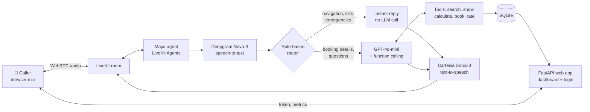

# MAYA — Multi-Domain Voice Agentic AI

**Maya** is a real-time voice AI agent you talk to from the browser. She doesn't just answer questions. She **completes tasks**: finds a place, quotes the price, books it, sends the confirmation, and asks you for a rating, all within one live conversation.

The same agent runs **four businesses: restaurant, hospital, hotel and airline**. Switching business means loading a different knowledge file. You can even switch mid-call just by saying *"actually, I need a flight."*

> 📄 The research paper on this project was published in **JAAFR**, November 2026 (Paper ID 516451).

---

## What Maya can do

| | |
|---|---|
| 🗣️ **Talk in real time** | Browser voice calls over LiveKit WebRTC, with streaming speech-to-text and text-to-speech |
| 🔎 **Answer from real data** | Prices, doctors, rooms and flights come only from the domain knowledge base. Maya never guesses |
| 🧮 **Quote prices** | Applies discounts (member, student, corporate, senior), taxes and service charges |
| ✅ **Book with a confirmation gate** | A booking is made only after Maya reads back the total and hears a clear "yes" |
| 📩 **Send confirmations** | Confirmation and receipt go out after booking |
| 🚑 **Handle emergencies** | Detects symptoms such as chest pain or trouble breathing, skips the LLM, books the nearest emergency department, alerts the caller's emergency contact and gives the 108 helpline |
| 🔀 **Switch domain by voice** | "Hotel... no, a flight" moves to flights. The dashboard screen follows the conversation |
| 📊 **Live dashboard** | Active calls, conversations, tasks completed, bookings, satisfaction and calls per domain |

---

## Architecture



### The hybrid router

Every caller turn goes through a **deterministic router before the LLM**:

- **Navigation is answered instantly with no LLM call.** "Show me hotels", "compare them", "tell me about Hotel X" and "which doctors do you have?" are answered straight from the knowledge file, and the dashboard updates. This saves tokens and is faster.
- **Emergencies skip the LLM entirely.** Symptom phrases trigger the emergency flow immediately.
- **Unfinished sentences are held.** If a caller says "book a table for..." and pauses, Maya waits for the rest instead of acting on half a sentence.
- **Scripted hotel booking.** A step-by-step slot-filling flow handles guests, companions' names, room, check-in date and nights, parsing phrases like *"day after tomorrow"*, *"the twenty fifth of December"* or *"three of us"*.
- **Everything else** (booking details, side questions) goes to the LLM with function calling.

---

## Tech stack

| Layer | Technology |
|---|---|
| **Voice framework** | LiveKit Agents (Python): `AgentSession`, `AgentServer`, WebRTC rooms |
| **Speech-to-text** | Deepgram **Nova-3** (via LiveKit Inference) |
| **Text-to-speech** | Cartesia **Sonic-3** (via LiveKit Inference) |
| **LLM** | OpenAI **GPT-4o-mini** (default), with function / tool calling |
| **Pluggable LLMs** | Gemini 2.5 Flash · OpenAI · any OpenAI-compatible API (e.g. Groq) · automatic fallback with `FallbackAdapter` |
| **Turn-taking** | LiveKit turn detector with tuned endpointing and interruption thresholds |
| **Noise cancellation** | ai-coustics audio enhancement (optional) |
| **Web backend** | FastAPI · Jinja2 templates · cookie sessions |
| **Auth** | Signup with **email OTP verification**, salted password hashing, login/logout |
| **Frontend** | HTML/CSS/JS · LiveKit JS client (browser calling) · Chart.js analytics |
| **Database** | SQLite (WAL mode): users, calls, bookings |
| **Language** | Python 3 |

---

## Reliability and safety

- **Confirmation gate:** `create_booking` refuses unless there is a listed place, the caller's real name, a total that was read back, and a clear "yes" given *after* hearing it. "Yes, but change the date" does **not** count as a yes.
- **No hallucinated prices:** the knowledge base is the only source of prices, names and availability.
- **No runaway loops:** tool steps per turn are capped (`MAX_TOOL_STEPS`).
- **No endless calls:** auto-hangup after a time limit or a long silence.
- **Provider resilience:** a custom HTTP transport strips the `extra_content` field that Groq rejects, and an automatic fallback to LiveKit Inference kicks in if the primary LLM fails.
- **Version-safe:** turn-tuning and session options are applied only if the installed LiveKit version supports them, so the agent always starts.

---

## Domains

| Domain | Knowledge base covers |
|---|---|
| 🍽️ Restaurant | Menu and prices, table sizes, member discount, service charge, hours |
| 🏥 Hospital | 8 doctors with specialty, fee and days; registration fee; senior-citizen discount; 24-hour emergency |
| 🏨 Hotel | 7 room types with rate, capacity and view; loyalty discount; tax; extra bed; amenities |
| ✈️ Flight | 8 routes from Bengaluru with times and fares; business class; member discount; baggage |

Each domain lives in `domains/<name>/` (`kb.txt` + `config.json`). Adding a new business means adding a folder.

---

## Project structure

```
.
├── src/
│   ├── agent.py            # Maya: LiveKit session, router, booking flow, safety
│   └── agent_tools.py      # Tools, DB writes, knowledge-base helpers
├── web/
│   ├── app.py              # FastAPI: auth, OTP, metrics API, domain switching
│   ├── templates/
│   │   ├── dashboard.html  # Live dashboard + voice terminal
│   │   └── domain.html     # Business detail page that follows the call
│   └── static/
├── domains/
│   ├── restaurant/   ├── hospital/   ├── hotel/   └── flight/
├── prototype/              # First version: 4 generic tools + test (no keys needed)
├── active_domain.txt
├── requirements.txt
└── .env.example
```

---

## Getting started

**Prerequisites:** Python 3.10+ and a free [LiveKit Cloud](https://cloud.livekit.io) project.

```bash
git clone https://github.com/sahana005-tech/MAYA---Multi-Domain-Voice-Agentic-AI-.git
cd MAYA---Multi-Domain-Voice-Agentic-AI-

python -m venv venv
source venv/bin/activate              # Windows: venv\Scripts\activate
pip install -r requirements.txt

cp .env.example .env.local            # add your LiveKit keys
```

Run the agent and the web app in two terminals:

```bash
# terminal 1: the voice agent
cd src && python agent.py dev

# terminal 2: the dashboard
cd web && uvicorn app:app --reload --port 8000
```

Open http://localhost:8000, sign up, tap the mic and say hello.

**Try it without any keys:** `cd prototype && python test_core.py` runs the full tool sequence (search → price → book → confirm) with no phone, LLM or API keys.

---

## Author

**Sahana H B**, GenAI Engineer & Security Researcher
[GitHub](https://github.com/sahana005-tech) · [LinkedIn](https://www.linkedin.com/in/sahana-hb-76b40a338)
